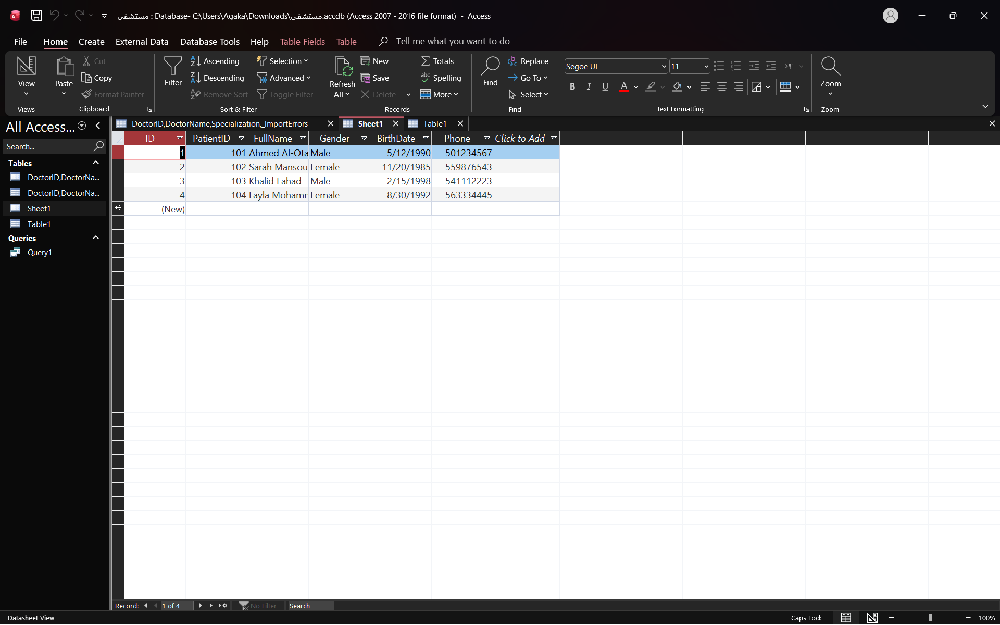

# Hospital Database Project

## Overview
A comprehensive relational database project built using Microsoft Access. This system was designed to streamline hospital management operations by organizing records for doctors, patients, and their scheduled appointments.

## Features
- **Patient & Doctor Management:** Stores detailed profiles for medical staff and patients.
- **Appointment Scheduling:** Tracks and manages appointments between patients and specific doctors.
- **Relational Integrity:** Utilizes Primary Keys (e.g., DoctorID, PatientID) and Foreign Keys to establish clear relationships between tables.
- **Data Validation:** Ensures accurate data entry and prevents orphaned records.

## Tools Used
- **Microsoft Access**
- **Relational Database Design** (Tables, Forms, Relationships)
- **Primary and Foreign Keys**

## How to Use
If you have Microsoft Access installed, you can download the `.accdb` file from this repository and open it to explore the tables, forms, and relationships. Alternatively, you can view the screenshots provided below.

## Project Result

*(You can upload a screenshot of your Microsoft Access relationships window here)*
